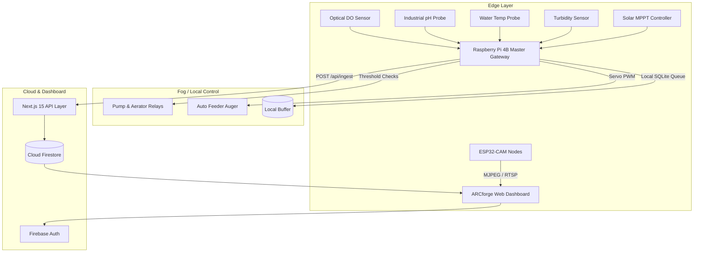

# ARCforge

<div align="center">
  <h3>Autonomous IoT Aquaculture Telemetry & Automation Platform</h3>
  <p>Real-time water quality monitoring, automated closed-loop aeration/feeding, live multi-node camera streams, and off-grid solar microgrid management.</p>
</div>

---

## 🌊 Overview

**ARCforge** is an open-source, production-ready full-stack IoT platform tailored for high-density aquaculture operations (such as Australian Redclaw crayfish, freshwater prawn, and recirculating tilapia systems).

Built with **Next.js 15 (App Router)**, **React 19**, **Tailwind CSS**, **Zustand**, and **Firebase**, ARCforge bridges physical edge devices (Raspberry Pi gateways, ESP32-CAM nodes, optical DO sensors, and solar inverters) with a mission-critical web dashboard.

---

## ⚡ Key Features

- **Real-Time Telemetry Matrix**: Live tracking of Dissolved Oxygen (mg/L), Water pH, Temperature (°C), Turbidity (NTU), and battery parameters.
- **Edge Automation Engine**: Closed-loop fail-safe threshold evaluation running on edge hardware with manual emergency kill-switch overrides.
- **Solar & LiFePO4 Microgrid Hub**: Live power-flow telemetry (Solar PV yield vs. active farm pump loads), MPPT efficiency metrics, and autonomy forecasting.
- **Live Node Camera Matrix**: Multi-camera grid with MJPEG/RTSP stream integration, low-latency node inspection, and snapshot triggers.
- **Automated Feeder Schedules**: Micro-controlled feeding regimens with manual pulse controls and historical log tracking.
- **Incident Alert Center**: Multi-level alerts (Critical, Warning, Info) with SMS dispatch routing and status tracking.
- **Predictive Analytics Suite**: Multi-parametric historical time-series with CSV/JSON export and AI-driven biological buffer diagnostics.

---

## 🛠️ Architecture



---

## 🚀 Quick Start

### 1. Prerequisites
- **Node.js**: `v18.18+` or `v20+`
- **npm** or **pnpm**

### 2. Installation
```bash
# Clone the repository
git clone https://github.com/rgdlcatacutan02-beep/ARCforge.git
cd ARCforge

# Install dependencies
npm install --legacy-peer-deps
```

### 3. Environment Setup
Copy `.env.example` to `.env.local` and configure your credentials:
```bash
cp .env.example .env.local
```

| Variable | Description | Default / Example |
| :--- | :--- | :--- |
| `INGEST_API_KEY` | Secret token required for hardware telemetry POSTs | `sk_live_938xj290n1` |
| `NEXT_PUBLIC_FIREBASE_API_KEY` | Public Firebase API Key | *Your Firebase Key* |
| `NEXT_PUBLIC_FIREBASE_PROJECT_ID`| Firebase Project ID | *Your Project ID* |
| `FIREBASE_ADMIN_PRIVATE_KEY` | Server-side Firestore admin key (optional) | *Service Account Key* |

### 4. Running Locally
```bash
npm run dev
```
Open [http://localhost:3000](http://localhost:3000) in your browser.

### 5. Production Build
```bash
npm run build
npm run start
```

---

## 🔌 Hardware Ingestion API

Edge microcontrollers (Raspberry Pi, ESP32, Arduino) report telemetry by sending HTTP `POST` requests to `/api/ingest`.

### Authentication
Include the API key either via query parameter or `Authorization` header:
- Header: `Authorization: Bearer <INGEST_API_KEY>` or `x-api-key: <INGEST_API_KEY>`
- Query: `?key=<INGEST_API_KEY>`

### Python (Raspberry Pi Edge Daemon)
```python
import requests

URL = "https://your-domain.com/api/ingest?key=sk_live_938xj290n1"

payload = {
    "device_id": "rpi4_master_node",
    "metrics": {
        "dissolvedOxygen": 6.82,
        "waterPh": 7.14,
        "temperature": 24.5,
        "turbidity": 3.2,
        "solarGeneration": 142.8,
        "batteryVoltage": 25.62,
        "batterySoc": 82
    }
}

response = requests.post(URL, json=payload, timeout=5)
print("Response:", response.json())
```

### Response Example
```json
{
  "success": true,
  "deviceId": "rpi4_master_node",
  "receivedAt": "2026-09-13T13:20:00.000Z",
  "commands": {
    "aerator": "AUTO_IDLE",
    "heater": "OFF"
  },
  "metricsReceived": 7
}
```

---

## 📷 Camera Node Configuration (ESP32-CAM)

1. Flash your ESP32-CAM with the standard Arduino CameraWebServer or MJPEG stream firmware.
2. Note the local stream URL (e.g. `http://192.168.1.120:81/stream`).
3. In ARCforge: Navigate to **Live Nodes** (`/cameras`), click **Add Camera**, and enter the stream URL.

---

## 🔒 Security Best Practices

- Protect `/api/ingest` with a cryptographically random `INGEST_API_KEY`.
- Maintain role-based access control (Admin / Viewer) for pump overrides and kill switches.
- Lock down Firestore security rules (`firestore.rules`) to authorized users in production.

---

## 📄 License
MIT License © 2026 ARCforge Contributors.
